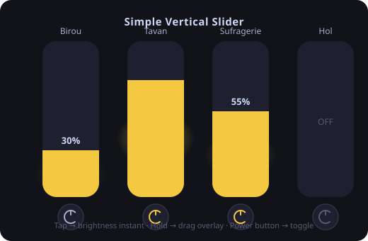

# Simple Vertical Slider

Vertical slider tiles for Home Assistant. **Tap to toggle, hold and drag to dim.**
Works with lights (and light groups), fans, switches, `input_boolean`, `number` /
`input_number` and media players (volume). Styled to match the
[EBusD Clas One card](https://github.com/phateks/EBusD-ClasONE-card) and the
[Energy Flow card](https://github.com/phateks/Energy-Flow-card).

[](https://my.home-assistant.io/redirect/hacs_repository/?owner=phateks&repository=vertical_sliders&category=plugin)



## Features

- **The whole tile is the slider.** Tap toggles. On a phone, touch and hold for a
  moment (you feel a tick and the percentage appears), then drag up/down to change
  the level from where it is now. With a mouse, drag right away.
- **Safe to scroll over.** A finger that moves before the hold just scrolls the page:
  nothing turns on, nothing opens. A touch that stops a scroll is not a tap.
- **One slider or many** in the same card (`entity` or `entities`).
- **Sizes itself.** Icon, name, percentage, padding and corners scale with the
  tile's real size. Short tiles put the icon and name on one row; very narrow tiles
  show only the icon. Set `width` / `height`, or let the dashboard grid decide.
- **Visible when off.** Off tiles keep a faint tint of their accent colour, so they
  don't disappear on dark backgrounds. On tiles get a coloured border and glow.
- **Accent per slider**, or the light's own colour.
- **Long press** (~0.8 s without moving) on lights with colour temperature opens a menu:
  brightness, colour temperature, more-info. On other entities it opens more-info.
- Light groups, fan speed steps, number ranges with units, media volume.
- The value you set stays on screen until Home Assistant confirms it.
- Keyboard: Enter toggles, arrow keys change the level.
- Dark and light themes; visual editor.
- **Column style** (`slider_style: column`): track with a round power button below.

## Install

### HACS (recommended)

Click the badge above, or in HACS → ⋮ → **Custom repositories** add
`https://github.com/phateks/vertical_sliders` with type **Dashboard**, then install
**Simple Vertical Slider** and reload the browser.

### Manual

Download `simple-vertical-slider.js` from the latest release, copy it to
`/config/www/`, and add a dashboard resource:

```yaml
url: /local/simple-vertical-slider.js
type: module
```

## Configuration

Everything can be set from the visual editor.

### One slider

```yaml
type: custom:simple-vertical-slider
entity: light.kitchen_light
name: Kitchen
icon: phu:kitchen-alt
accent: "#ffcf8a"
```

### Several sliders in one card

```yaml
type: custom:simple-vertical-slider
columns: 4
height: 170px
entities:
  - entity: light.kitchen_light
    name: Kitchen
  - entity: light.desk_light_mosfet_led
    name: Desk
    accent: "#6cb8e8"
  - switch.hallway_light
  - entity: fan.bedroom_lamp
    name: Bedroom Fan
```

### Card options

| Option | Default | Description |
|---|---|---|
| `entity` | | Single-slider form. Not used when `entities` has items. |
| `name`, `icon`, `accent` | | For the single form. |
| `entities` | | List of sliders (strings or objects, see below). |
| `slider_style` | `tile` | `tile` or `column`. |
| `width`, `height` | grid | CSS size per slider, e.g. `120px`. Unset = follow the dashboard. |
| `columns` | all | Sliders per row. |
| `gap` | `10` | Space between sliders, px. |
| `drag_mode` | `relative` | `relative` (from the current level) or `absolute` (level under the finger). Column style defaults to `absolute`. |
| `sensitivity` | `1` | Relative drag: 1 = full tile height is 100 %. Higher = finer. |
| `glow` | `true` | Coloured border and glow when on. |
| `use_light_color` | `true` | Lights without an `accent` use the bulb's colour. |
| `default_accent` | | Accent for every slider without its own. |

### Slider options (`entities` items)

| Option | Description |
|---|---|
| `entity` | Required. |
| `name` | Defaults to the friendly name. |
| `icon` | Defaults to the entity's icon. |
| `accent` | Colour, e.g. `#ffcf8a`. Defaults by domain. |
| `min`, `max`, `step` | `number` / `input_number` overrides. |

### Behaviour by domain

Drag = touch, hold ~0.3 s, then move (mouse: move right away). Long press = ~0.8 s still.

| Domain | Tap | Drag | Long press |
|---|---|---|---|
| `light` | toggle | brightness (0 % turns off) | menu if colour temp, else more-info |
| `fan` | toggle | speed (snaps to the fan's steps) | more-info |
| `switch`, `input_boolean` | toggle | — | more-info |
| `number`, `input_number` | more-info | value | more-info |
| `media_player` | mute | volume | more-info |

### Theming

The card exposes CSS variables you can set with card-mod or a theme:
`--svs-surface`, `--svs-surface-on`, `--svs-off-name`, `--svs-on-name`,
`--svs-radius`, `--svs-aspect` (tile shape when the dashboard gives no height).

## Development

```bash
npm install
npm run build   # writes simple-vertical-slider.js
npm run watch
```

Releases are made by the **Release** GitHub workflow (Actions → Release → version).

## License

MIT
